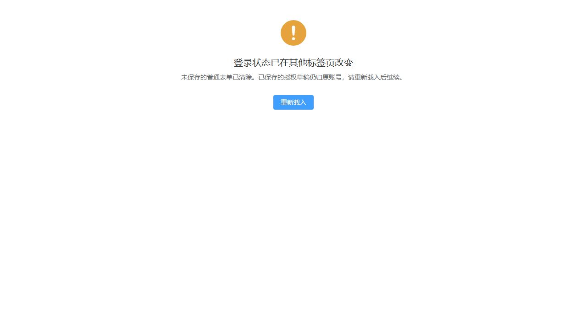

# 跨标签租户会话同步验收

日期：2026-10-17。范围为 T-FE-071，按 M2/N1 实施；不更换 Bearer 认证、不扩大到独立平台运营会话、不增加普通表单草稿。

## 行为与工程验证

| 检查 | 命令或方式 | 结果 |
|---|---|---|
| 初始行为红测 | `pnpm test:run src/utils/tenant-session.spec.ts` | 9 项中 7 失败、2 通过；缺少通知前请求阻断、事件失效和迟到响应拒绝 |
| 完整前端测试 | `pnpm test:run` | 53 个文件、590 项通过 |
| 最终测试夹具复验 | `pnpm test:run src/store/modules/user.spec.ts` | 30 项通过；仅调整 Pinia 测试夹具赋值写法，行为不变 |
| 类型检查 | `pnpm typecheck` | 最终通过；此前新增测试的 `$patch` 深层类型不兼容已改为普通类型化属性赋值 |
| 代码规范 | `pnpm lint:check` | 通过；最后一处测试夹具调整也经定向 Prettier 格式化 |
| DTO 对账 | `pnpm contracts:check` | 44 组通过；未新增响应 DTO |
| 生产构建 | `pnpm build` | 通过，31.07 秒；生产实现后续未再修改 |

测试覆盖：storage/clear、focus、pageshow、visibilitychange；通知尚未到达时先阻断请求；请求创建与拦截器执行之间换身份；校验与取请求头之间共享令牌变化时仍固定旧请求身份；迟到成功/401/403 不执行响应回调、不注销新会话、不刷新新权限；本页退出仍使用显式旧令牌完成服务端注销；Cookie 自然过期保留既有过期处置；阻断不自动解除；当前页清理不写共享存储；平台认证分支继续独立。

## 浏览器实测

使用本地 `VITE_MOCK_LOGIN=true` 预览与临时模拟会话按钮页，通过真实双标签操作验证。使用 dummy mock token，无真实账号登录、验证码求解或后端业务写入；临时页面与服务已清理。

1. 原标签页输入未提交内容，另一页写入模拟登录会话；原表单消失，仅显示会话变化提示和重新载入按钮。
2. 原页为 admin 首页，另一页切换 sec；原页旧身份界面消失，确认后进入 sec 首页。
3. 另一页清除模拟会话；原页再次阻断，确认后进入登录页。
4. Hash 路由初版仅更新 hash、没有重建 JS 运行时的问题已修正；再次点击实测成功，并以 Hash/H5 导航测试保护。

此浏览器验收证明根界面卸载、阻断提示与重新载入，不代表真实后端登录或所有业务表单的逐页验收。已有授权草稿代码未改，沿用账号/租户隔离与成功存盘恢复机制；卸载仍走既有持久化/停止监听/取消在途状态流程。已发送写请求不承诺回滚，不自动重放。

## 代码轨

- `utils/tenant-session.ts:24`：页面身份与本地代次复核，不写共享凭据；失效保持阻断至完整重载。
- `utils/http/index.ts:272/120/155/178/218`：创建时记录、发送前复核、请求头固定、成功/失败处理前复核；阻断迟到回调及新会话注销。
- `store/modules/user.ts:61/238`：本页清理与共享凭据注销分离，旧标签页不能借退出入口清掉新身份；现有主动退出仍发送旧令牌。
- `main.ts:63`、`App.vue`：先安装边界再进入路由，失效移除旧页面/弹窗；平台页面不受租户失效提示干扰。
- `tenant-session.ts:106`：Hash 导航实际重建页面，避免确认后卡在旧运行时。该事实性缺陷已通过浏览器复现、修复并补行为测试。

本任务未解决 P0/P1/P2/P3：无。没有无调用方的新框架或存储机制。范围外同类风险：平台 store 只在初始化/挂载刷新 account，而 HTTP platform 分支按次读取共享令牌（`store/modules/platform.ts:13`、`utils/http/index.ts:107`）；登记 Q-082，由用户决定是否扩大实施范围，未宣称已解决。

## 文档轨

M2/N1 已归位登录设计：未保存普通输入丢弃、已有授权草稿不转交新身份、确认后进入当前会话首页/登录页、Hash 真重载、后台恢复和请求竞态均说明。强制下线 K1、验证码 L1 的暂缓不被本任务撤回，HttpOnly 改造仍待决定。Q-068 只收敛租户同步子项，平台同类问题单独登记 Q-082。

无未解决文档缺陷；归档链接与问题锚点已核对。本任务仅改前端及文档，未运行 Maven 后端回归。完整临时日志位于 `.tmp/T-FE-071/`，本记录以内联命令和结果为持久证据。
