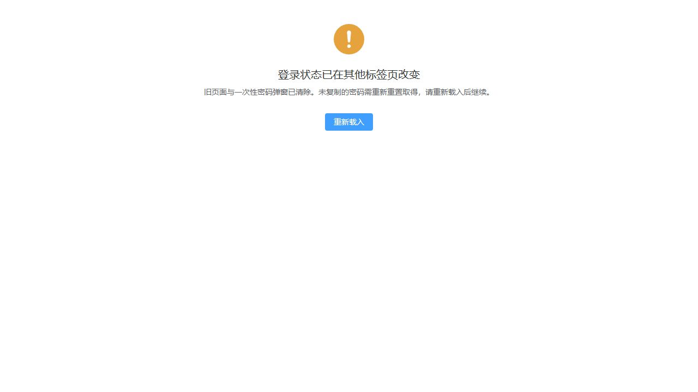

# 独立平台跨标签同步验收

日期：2026-10-17。基础提交 `2f2461d60`；O1 扩展平台范围，沿用 N1 的清理和确认重载行为。平台与租户只共享算法，不共享会话状态。

## 验证

| 检查 | 入口 | 结果 |
|---|---|---|
| 行为红测 | `pnpm test:run src/utils/http/index.spec.ts` | 旧平台分支把请求创建后的新令牌 operator-B 加入旧请求，负向断言失败 |
| 全部前端测试 | `pnpm test:run` | 54 个文件、600 项通过 |
| 类型检查 | `pnpm typecheck` | 通过 |
| 规范检查 | `pnpm lint:check` | 通过 |
| DTO 对账 | `pnpm contracts:check` | 44 组通过；无响应结构变更 |
| 生产构建 | `pnpm build` | 通过，33.01 秒 |

新增证据覆盖平台请求创建/发送时序、固定请求头、迟到成功/401/403（含一次性凭据响应）丢弃、显式旧令牌注销、本域失效不阻断另一域、旧清理句柄不关闭新边界，以及旧平台页不能清除新平台与租户凭据。原租户测试沿用并通过。

## 浏览器验证

使用本地 Vite、临时 mock 平台 API 与模拟会话按钮页，三标签分别为平台页面、租户页面、模拟控制页。后端代理指向不可用的本地端口，未连接真实业务服务；模拟账号创建只返回固定测试对象与 `PREVIEW-ONLY-NOT-A-CREDENTIAL` 展示文本，不创建真实账号或凭据。临时 mock/HTML/服务器已清理。

- 平台甲进入平台账号页，填写测试账号并通过 mock 返回一次性展示弹窗。
- 另一页切换平台乙：旧平台页面和整个密码弹窗均消失，只显示阻断提示；同浏览器租户 admin 首页保持可用。
- 点击重新载入：完整重载后进入平台租户列表，显示平台乙。
- 另一页退出平台：再次阻断，确认后进入 `/platform/login`。验证码后端未接入，因此未验证真实平台登录；该步骤仅验证落点。

## 代码轨

实证通过项：`session-boundary.ts` 为实际两域消费者共用工厂，各自闭包保存 expectedToken/revision/blocked/listeners；两入口按各自存储键观察，页面展示与清理按当前认证域选择。租户自然 Cookie 过期例外保留，平台不借用此例外。请求在创建时记录并固定令牌，成功/错误处理前复核；迟到平台响应不显示旧凭据、不删除新会话。明确发出的退出请求继续持原显式令牌完成注销。本地清理只改所属 store/UI，不持久化或交付旧密码。

共用抽象有 tenant/platform 两个现役消费者，未新增消息中间件、轮询、服务端接口或通用草稿。平台与租户读写、路由和响应路径已分别核对。无未解决 P0/P1/P2/P3；无新增存疑决策项。

## 文档轨

O1 已回写登录设计的平台独立边界、一次性密码丢失后的重置交付方式、确认后落点与强制改密优先级。Q-082 按独立任务收敛，Q-068 的强制下线/验证码暂缓与 HttpOnly 待决定不随本任务关闭。任务单卡归档及链接已核对。

本次仅修改前端与文档，未运行 Maven 后端回归。已经发出的服务端写入不承诺撤回；响应被丢弃或一次性展示关闭后仍须查询结果并按已有重置流程恢复交付，不自动重放写请求。原始日志保留于 `.tmp/T-FE-072/`，本记录内联验证结果作为持久依据。
