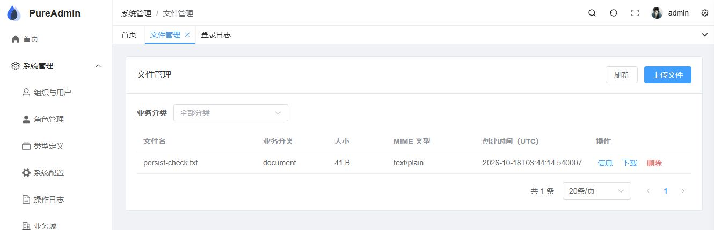

# 顶栏裁剪与标准文件能力验收

## 范围与基线

T-FE-077 / T-ACCESS-116 / T-FE-078，基线 31f84fffe。用户既定范围：移除全部演示通知入口；文件作为标准能力并提供最小页面；内置管理员具有全分类 CREATE/VIEW/DELETE 且可转授，普通用户无默认文件授权。新增确认：补齐 Sa-Token 现有 Jackson 2 会话组件必需的 runtime 日期模块，不更换序列化器和 Redis 数据格式。T-PERM-036 保持暂缓。

## 定向证据

- FileAppServiceImplTest 已有详情用例增加 JSON bizType 断言：旧实现 1 失败，修复后 26 项单测通过。
- TenantOpeningPgIT 新用例通过真实 tenant/create 验证五条 file 路由、文件菜单、三条 ALL/canGrant/BOOTSTRAP_SEED 授权：旧实现 1 失败，修复后本类 8 项通过。数据库只读断言不补路由或授权。
- 首次组合 PG 命令虽然 Maven SUCCESS，其中 AccessBootstrapPgIT 20 项和 FileServiceSecurityPgIT 11 项因一个 fork 的 Docker 探测失败被跳过，不计通过。随后实跑：文件安全 11 项通过；初始化 19 项通过、1 项旧可转授计数预期失败。将已批准新增的文件三条计入总数 7 后，单例复跑通过；最终完整回归另核零跳过。
- E2E 在现有真实三服务进程拓扑中执行独立 FileCapabilityE2eScenario，使用独立新租户和角色，不复制启动框架。标准 tenant/create → 管理员上传新分类与 document → detail/page/download → 普通用户默认拒绝 → 通过 apply-grant-plan 委派 document VIEW → 只能读该分类、不能上传/删除 → 跨租户拒绝 → 撤权后 30 秒内拒绝 → 管理员删除。定向标准场景 1 项通过，未手工补 file 路由/默认授权。
- 新前端 API 反例：没有错误 Blob 识别时 HTTP 200/403 两个 JSON 错误用例失败；修复后通过。页面旧筛选迟到响应清空新结果的反例失败，修复后通过。其他用例覆盖无 VIEW 不发读请求但 CREATE 可上传、会话/分类/卸载后不下载、取消上传结果未知且不重试、删除失败保留行与确认期间换会话不发请求。

## 正式运行包与真实浏览器

隔离项目 accessmesh-file-qa-20261018 使用权威原样 DDL、新 PG/Redis、独立命名文件卷；Gateway 19080、access-service 19100、Vite 18848。使用当前正式 fat JAR，前端未开启 mock。

初次正式 JAR 启动均失败：sa-token-jackson 的 optional jackson-datatype-jsr310 未打包，LocalDateTimeSerializer 缺失。补齐两个宿主 runtime 依赖后重新 package，两个服务启动成功。经 Gateway 平台登录、正常 tenant/create 开通 file-qa、首次改密后正式登录，没有修改已有开发数据库。

- 浏览器 Cookie/CSRF 通道上传 file-management-qa.txt，看到真实 bizType=document、大小与 MIME；详情一致。
- image 筛选得到真实空页，切回 document 能见原文件；删除确认后真实删除、列表刷新。测试删除和 CAPTCHA 已得到用户操作时确认。
- 初次文件下载点击无输出，工具未捕获事件、用户也确认没有文件。改为链接临时挂入 DOM、点击后移除、下一事件任务释放 Object URL，之后工具取得 D:/download/persist-check.txt，内容为 AccessMesh file capability verification. 加换行，SHA-256=630ed22791b9a4ca99073af08e92c00ce6cc579144c387c46e9abf362e6388fa。同类扫描的审计导出实际下载成功，未仅凭相似代码扩修。
- 上传持久化验证文件后 force-recreate 仅隔离 access-service 容器，原命名卷保留；原文件经 Gateway 再次下载，字节一致。没有删除既有数据库或文件卷。
- 竖向、横向、混合导航均实际切换确认无铃铛/红点/演示消息；恢复竖向布局，保留正常邻接控件。没有为纯删除添加源字符串镜像测试。

## 本地代码轨

主代理独立只读核对固定图、新租户链、原文件安全校验、前端请求/生命周期、正式 JAR 与测试：

- 五条路由使用既有操作准入；文件服务继续按租户元数据与文件夹通过 QueryGate 校验，没有新增免登端点。
- 新增 ALL/canGrant 只限已确认的文件三种操作；初始化运行资源类型集合已同步，FileResp 分类直接取 bucket_name，没有路径猜测或公开静态地址。
- 前端沿用公共 HTTP Cookie/CSRF、会话代际、列表与权限工具；只将分页工具已有 clear 暴露给页面。文件页私有代际守卫处理页面/筛选变化，与 HTTP 的会话守卫互补。无 VIEW 不发起列表/详情。
- 实证修正：初始化旧计数；筛选旧请求不得清空新结果；真实下载生命周期；上传确定拒绝应保留后端原因：HTTP 403/413 反例在旧处理上失败，修复后通过，网络/取消仍提示结果未知。
- 过度设计检查：未新增消息中心、目录服务、权限编辑器、自动重试、后台上传任务、存储抽象或会话兼容层。E2E 复用已运行进程，只隔离数据；没有新增容器测试框架。没有未处置设计取舍。

已处置 P2：`access-service/pom.xml:160`、`gateway/pom.xml:65` 的正式运行包依赖缺口；`frontend/src/views/system/file/useFileManager.ts:46` 的迟到筛选清空、`:98` 的下载生命周期、`:131` 的确定拒绝提示。已处置 P3：`AccessBootstrapPgIT.java:311` 的可转授总数旧预期。实证通过面见上方清单；终态无未处置 P0–P3，存疑待用户决策项为无。

## 本地文档轨

代码轨排查完成后，独立核对任务 design_refs、当前契约、架构、部署与索引：

- 已删除“文件暂无前端消费者/尚未实现”等当前口径，登记 bizType 及 DTO 对账；文件下载不再描述为全仓唯一二进制响应例外。
- 固定图当前量更新为 120 API 资源、119 映射、18 菜单、61 授权；可转授例外为原四条加文件三条。历史 superseded 契约保留追溯，不作当前实现依据。
- 部署说明区分新租户与旧库，保留备份重建/单实例/卷持久化边界；没有自动补权或在线迁移承诺。发布须检验正式 JAR，不能以测试类路径成功代替打包验证。
- 终态归档已同步任务、计划、问题锚点、三个 README 与相对链接；T-PERM-036 仍保持暂缓。

## 完整回归

| 状态 | 命令/范围 | 实际结果 |
|---|---|---|
| passed | `mvn test -T 1C` | 各 Surefire execution 汇总 2976 项测试执行，0 失败/错误/跳过，全部 reactor SUCCESS；含 E2E/heavy，17:42 min |
| passed | `pnpm -C frontend test` | 58 文件、630 项通过 |
| passed | `pnpm -C frontend typecheck` | tsc 与 vue-tsc 通过 |
| passed | `pnpm -C frontend lint:check` | ESLint、Prettier、Stylelint 通过 |
| passed | `pnpm -C frontend contracts:check` | 46 组 DTO 字段对账通过 |
| passed | `pnpm -C frontend build` | 正式构建通过 |

Maven 前确认 9100 无开发服务占用；运行前后 1617 个源码/构建输入哈希一致。Maven 完成后仅修前端确定拒绝提示，并重新完成上述全部前端检查；后端源码未再变更。[变更源码哈希](source-sha256.json)、[运行包记录](runtime-manifest.json)、[后端执行汇总](backend-result.json)与[原始日志哈希](log-sha256.json)同目录保存。完整原始日志位于 `.tmp/standard-capability/`；首次红测的编译错误和一次 PowerShell Maven 参数解析错误不计为行为反例。

本地代码/文档两轨完成，无未决事项；归档后相对链接与残留状态检查已通过。隔离 QA 服务和 Vite 已停止，测试数据库及文件卷保留。没有运行外部 AI 评审，没有部署生产或改动既有开发环境数据。

[横向布局](horizontal.png)与[混合布局](mixed.png)保存无演示铃铛的页面证据。
